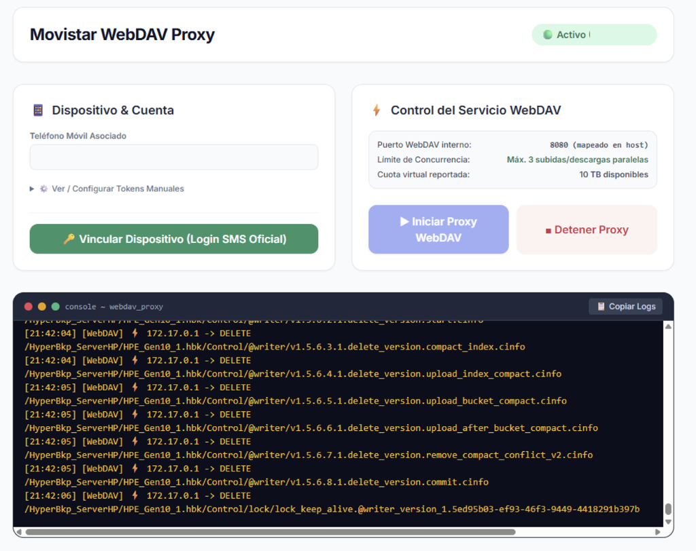

# Movistar / O2 Cloud WebDAV Proxy ☁️🔐

[](https://hub.docker.com/r/uniextra/movistar-webdav-proxy)
[](https://goreportcard.com/report/github.com/uniextra/MovistarWebDAVProxy)
[](https://opensource.org/licenses/MIT)
[](https://tools.ietf.org/html/rfc4918)
[](https://hub.docker.com/r/uniextra/movistar-webdav-proxy)
[](https://hub.docker.com/r/uniextra/movistar-webdav-proxy)

> [!NOTE]
> **Aviso de Proyecto No Oficial e Independiente:** Este software es un desarrollo comunitario y no oficial para fines de interoperabilidad y copias de seguridad personales. No está afiliado, asociado, patrocinado ni respaldado por Telefónica, S.A. ni por Movistar/O2. Consulta [DISCLAIMER.md](DISCLAIMER.md) y [TRADEMARKS.md](TRADEMARKS.md) para más información.

Proxy WebDAV nativo de alto rendimiento escrito íntegramente en **Go** que traduce peticiones estándar WebDAV (**Synology HyperBackup**, **Duplicati**, **Rclone**, mapeo de discos en **Windows / macOS / Linux**) permitiendo la interoperabilidad y sincronización directa con los servicios en la nube de **Movistar Cloud España** y **O2 Cloud** de forma local, en tiempo real y sin intermediarios.

Transforma tu almacenamiento ilimitado en una unidad remota rápida, transparente y segura para tus servidores, ordenadores y copias de seguridad de NAS.

<p align="center">
  
</p>

---

## 📑 Índice de Contenidos

1. [🌟 Características Principales](#-características-principales)
2. [🐳 Despliegue con Docker](#-despliegue-con-docker)
3. [🔑 Vinculación Inicial (Emparejamiento SMS)](#-vinculación-inicial-emparejamiento-sms)
4. [💻 Mapear como Unidad de Red (Windows, macOS, Linux)](#-mapear-como-unidad-de-red-windows-macos-linux)
5. [⚙️ Clientes de Copia de Seguridad (HyperBackup, Duplicati)](#️-clientes-de-copia-de-seguridad-hyperbackup-duplicati)
6. [🧹 Filtro Inteligente de Basura del SO (v2.1.0)](#-filtro-inteligente-de-basura-del-so-v210)
7. [⚠️ Limitaciones Conocidas de Movistar / O2 Cloud](#️-limitaciones-conocidas-de-movistar--o2-cloud)
8. [📚 Documentación Detallada](#-documentación-detallada)
9. [⚖️ Aviso Legal y Marcas](#️-aviso-legal-y-marcas)
10. [📄 Licencia](#-licencia)

---

## 🌟 Características Principales

* 🚀 **Extremadamente Ligero y Eficiente (Go Nativo):** Binario estático compilado en contenedor Docker de solo **~20 MB** con consumo de memoria de apenas **~6.5 MB de RAM**.
* 🔄 **Traducción Completa de WebDAV (RFC 4918):** Soporta `PROPFIND` (paginación automática de miles de archivos), `PUT` (streaming directo a disco sin saturar RAM), `GET`/`HEAD` (con soporte para peticiones `Range` y streaming por chunks), `MKCOL`, `DELETE`, `MOVE`, `COPY` y bloqueos `LOCK`/`UNLOCK`.
* 📊 **Cuotas Virtuales RFC 4331:** Informa del espacio disponible para que asistentes como Synology DSM o Duplicati no fallen por chequeos de espacio insuficiente.
* 🚦 **Semáforo de Concurrencia 1:1 (Alineado con Cliente Oficial):** Serializa las transferencias y peticiones como el cliente nativo de escritorio, optimizando subidas y descargas sin provocar bloqueos de *rate-limit* ni *WAF*.
* 📱 **Autenticación Compatible + OAuth2 PKCE:** Implementa el flujo de autenticación del cliente de escritorio (`omh windows client`) con sincronización milimétrica de timestamps y soporte para verificación SMS oficial desde el navegador.
* 🛡️ **Protección contra Colisiones:** Previene la creación de duplicados automáticos como ` (1)` al actualizar o mover archivos.
* 🧹 **Absorbedor de Basura de SO (*DevNull Absorber*):** Filtra y neutraliza automáticamente archivos innecesarios de Windows, macOS y Linux.

---

## 🐳 Despliegue con Docker

### Opción 1: Docker Compose (Recomendado)

Crea un archivo `docker-compose.yml`:

```yaml
services:
  movistar-webdav-proxy:
    image: uniextra/movistar-webdav-proxy:latest
    container_name: movistar-webdav-proxy
    restart: unless-stopped
    read_only: true
    tmpfs:
      - /tmp
    security_opt:
      - no-new-privileges:true
    environment:
      - WEBDAV_USER=admin
      - WEBDAV_PASSWORD=TuPasswordSeguroAqui
      # Opcional: credenciales distintas para el panel web (si no se definen, usa las de WebDAV)
      # - WEBUI_USER=admin
      # - WEBUI_PASSWORD=OtroPasswordSeguro
    ports:
      - "${BIND_IP:-0.0.0.0}:5000:5000"   # Panel Web de Gestión y Logs (usa BIND_IP=127.0.0.1 para solo localhost)
      - "${BIND_IP:-0.0.0.0}:5050:8080"   # Endpoint WebDAV (puerto 5050 en el host)
    volumes:
      - movistar_tokens:/app/tokens

volumes:
  movistar_tokens:
    name: movistar_webdav_tokens
```

Inicia el servicio:
```bash
docker compose up -d
```

### Opción 2: Docker CLI

```bash
docker run -d \
  --name movistar-webdav-proxy \
  --restart unless-stopped \
  -e WEBDAV_USER=admin \
  -e WEBDAV_PASSWORD=TuPasswordSeguroAqui \
  -p 5000:5000 \
  -p 5050:8080 \
  -v movistar_webdav_tokens:/app/tokens \
  uniextra/movistar-webdav-proxy:latest
```

---

## 🔒 Seguridad y Variables de Entorno

### Recomendaciones de Seguridad y Autenticación
* **Autenticación HTTP Basic Robusta y Normalización:** Tanto el servidor WebDAV como el panel web validan usuario y contraseña en tiempo constante contra ataques de temporización (`subtle.ConstantTimeCompare`).
  * **Normalización de usuarios Windows:** Los prefijos de dominio habituales de Windows WebClient (`DOMAIN\usuario` o `\usuario`) se normalizan automáticamente a `usuario`, ignorando espacios en blanco accidentales.
  * **Preservación intacta de contraseñas:** La contraseña se preserva exactamente tal como se envía, permitiendo contraseñas complejas con dos puntos (`:`) o espacios internos.
  * **Desafío RFC 4918 (`401 Unauthorized`):** Toda petición no autenticada o con credenciales erróneas recibe un código HTTP `401 Unauthorized` junto al encabezado estándar `WWW-Authenticate: Basic realm="WebDAV"`.
  * **Descubrimiento Windows WebClient:** La petición inicial `OPTIONS /` sin credenciales devuelve `200 OK` con `MS-Author-Via: DAV` y cabeceras de conformidad `DAV: 1, 2`, permitiendo al explorador de Windows identificar el servicio antes de solicitar credenciales en `PROPFIND /`.
* **Topologías de Red Docker y Detección de IP:**
  * **Docker Bridge (por defecto):** Mediante `BRUTE_FORCE_EXCLUDED_IPS`, las subredes puente estándar de Docker (`172.17.0.0/16`, `172.18.0.0/16`) y loopback (`127.0.0.1`, `::1`) quedan excluidas del bloqueo por fuerza bruta (HTTP 429). Esto evita que múltiples clientes compartiendo el gateway de Docker (ej. `172.18.0.1`) queden bloqueados accidentalmente. **La autenticación Basic Auth se exige y valida en todo momento (las exclusiones solo evitan el baneo 429, nunca eluden la clave).**
  * **Proxy Inverso (Nginx, Nginx Proxy Manager, Traefik, Caddy, Synology DSM Reverse Proxy):**
    * Al configurar `TRUSTED_PROXIES` (ej. `127.0.0.1,172.18.0.0/16`), el proxy extrae la IP real del cliente de `X-Forwarded-For` o `X-Real-IP`. Si la petición proviene de un origen no confiable, las cabeceras de reenvío se descartan de forma estricta para evitar spoofing.
    * ⚠️ **Importante para subidas de archivos grandes (`413 Request Entity Too Large`):** Si sitúas el contenedor detrás de **Nginx** o **Nginx Proxy Manager (NPM)**, debes desactivar el límite de cuerpo y el buffering en la pestaña *Advanced* (*Custom Nginx Configuration*) del proxy inverso para que no corte las subidas WebDAV de varios GB:
      ```nginx
      client_max_body_size 0;
      proxy_request_buffering off;
      proxy_read_timeout 3600s;
      proxy_send_timeout 3600s;
      ```
    * En Linux con clientes de escritorio basados en **GVFS** (Thunar / Nautilus `davs://`), ten en cuenta que `gvfsd-dav` / `libsoup` tiene una limitación histórica de entero con signo de 32 bits (**2 GiB**) por archivo; para subir archivos de entre 2 GB y 4 GB desde Linux se recomienda usar **Rclone** o `curl`.
  * **Docker Host (`network_mode: host`):** En Linux nativo permite ver la IP real directa del socket. En Docker Desktop (Windows/macOS), debido a la máquina virtual interna de virtualización, el modo bridge con mapeo de puertos o proxy inverso es la topología recomendada.
* **No exponer directamente a Internet:** Si necesitas acceder desde fuera de tu red local, coloca siempre un proxy inverso con **TLS/HTTPS** delante (Caddy, Nginx, Traefik o túnel VPN/WireGuard/Tailscale).
* **Contenedor sin privilegios (`non-root`):** La imagen oficial ejecuta el servidor bajo el usuario sin privilegios `app` (`UID 10001`). En actualizaciones sobre volúmenes existentes, el entrypoint migra automáticamente los permisos de `/app/tokens` antes de soltar privilegios.

### Tabla de Variables de Entorno

| Variable | Por defecto | Descripción |
| :--- | :--- | :--- |
| `WEBDAV_USER` | *(vacío)* | Usuario para clientes WebDAV (y para el panel web si `WEBUI_USER` no se define). |
| `WEBDAV_PASSWORD` | *(vacío)* | Contraseña en texto plano para clientes WebDAV. |
| `WEBDAV_PASSWORD_HASH` | *(vacío)* | Alternativa a `WEBDAV_PASSWORD`: hash SHA-256 en hexadecimal (ej. `sha256:e3b0c44...`). |
| `WEBUI_USER` | `WEBDAV_USER` | Usuario específico para el panel de control web (`:5000`). |
| `WEBUI_PASSWORD` | `WEBDAV_PASSWORD` | Contraseña específica para el panel de control web. |
| `REQUIRE_AUTH` | `false` | Si es `true`, el servidor aborta el arranque si no se han configurado credenciales. |
| `AUTH_DISABLED` | `false` | Si es `true`, desactiva explícitamente la autenticación. |
| `PORT` | `5000` | Puerto interno del servidor del Panel Web. |
| `WEBDAV_PORT` | `8080` | Puerto interno del servidor WebDAV. |
| `TOKENS_DIR` | `/app/tokens` | Directorio donde se almacenan las credenciales OAuth2 (`0700`). |
| `TOKENS_ENCRYPTION_KEY` | *(vacío)* | Clave opcional para cifrar en reposo (AES-256-GCM) los tokens guardados en disco. |
| `MAX_UPLOAD_MB` | `4096` | Tamaño máximo permitido por archivo en subidas `PUT` (en MB). |
| `WEBDAV_BUFFER_MB` | `32` | Tamaño máximo del búfer en RAM (MB) antes de hacer spool a disco (óptimo Duplicati). |
| `TRUSTED_PROXIES` | *(vacío)* | Lista de IPs/CIDRs de proxies de confianza para evaluar `X-Forwarded-For` / `X-Real-IP`. |
| `BRUTE_FORCE_EXCLUDED_IPS` | `127.0.0.1,::1,172.17.0.0/16,172.18.0.0/16` | IPs/subredes exentas de bloqueo HTTP 429 (mantiene Basic Auth activo). |
| `WEBDAV_TMPDIR` | `/tmp` | Directorio para archivos temporales durante subidas mayores al buffer RAM. |
| `SHUTDOWN_TIMEOUT_SEC` | `30` | Tiempo máximo de espera (segundos) para un apagado ordenado. |

> **Nota Legal / Términos de Uso:** Este proyecto es una herramienta independiente de interoperabilidad personal y no está afiliado, patrocinado ni respaldado por Telefónica / Movistar / O2. El cliente utiliza los identificadores OAuth del cliente de escritorio para permitir al titular legítimo de la línea acceder a su propio espacio mediante el estándar WebDAV. Úsalo bajo tu propia responsabilidad y conforme a las condiciones de tu servicio contratado.

---

## 🔑 Vinculación Inicial (Emparejamiento SMS)

1. Abre tu navegador y entra al panel de control: `http://IP_DE_TU_SERVIDOR:5000`.
2. Haz clic en **"Vincular Dispositivo (OAuth2 SMS)"**.
3. Selecciona tu proveedor (**Movistar Cloud** u **O2 Cloud**) e introduce tu número de teléfono móvil.
4. Pulsa en **"Abrir Página de Login en Nueva Pestaña"** para acceder al portal oficial de Telefónica y escribe el código SMS recibido.
5. Copia la URL final redirigida en tu navegador (ej: `https://micloud.movistar.es/...code=...`), pégala en el panel y pulsa **"Completar Vinculación"**.
6. ¡Listo! El servidor WebDAV quedará activo y escuchando en el puerto `5050`.

---

## 💻 Mapear como Unidad de Red (Windows, macOS, Linux)

Puedes montar la nube como si fuera un disco duro o carpeta compartida local:

| Sistema Operativo | Método Rápido | Ruta / Comando |
| :--- | :--- | :--- |
| **🪟 Windows** | ⚠️ No soportado nativamente (Usar Rclone + WinFsp) | Ver [Aviso de Soporte en Windows](#-soporte-limitado-y-montaje-en-windows) |
| **🍏 macOS** | Finder (`Cmd + K`) | `http://TU_IP:5050` (Usuario: `admin` / Clave: `admin`) |
| **🐧 Linux** | GNOME Nautilus / `davfs2` | `dav://TU_IP:5050/` o `mount -t davfs http://TU_IP:5050 /mnt/cloud` |

### 🪟 Soporte Limitado y Montaje en Windows

> [!WARNING]
> **El montaje como unidad de red nativa en Windows (`net use` / `WebClient`) NO está soportado al 100% ni se recomienda para uso diario.**  
> El cliente WebDAV integrado de Windows (`mrxdav.sys` / servicio `WebClient`) es un componente heredado que **Microsoft marcó oficialmente como obsoleto (*deprecated*) en 2023** y presenta graves deficiencias estructurales del propio sistema operativo:
> 
> 1. **Descarga obligatoria de archivos enteros al interactuar:** El Explorador de Windows intenta descargar a su caché local (`TfsStore`) el archivo completo (incluso si pesa varios gigabytes) solo para extraer miniaturas o al pulsar la tecla Supr para borrarlo.
> 2. **Fallo de reconexión tras reiniciar ([Microsoft KB 2673544](https://learn.microsoft.com/en-US/troubleshoot/windows-client/networking/cannot-automatically-reconnect-dav-share)):** Por diseño de Windows, el Administrador de Credenciales envía una contraseña vacía al reconectar tras un reinicio, provocando fallos continuos de autenticación y bloqueos en bucle.
> 3. **Límites de tamaño y timeouts:** Windows impone un límite de 4 GB por archivo en su registro y tiempos de espera agresivos de 60 segundos.
>
> 💡 **Solución Oficial Recomendada en Windows:**  
> Si necesitas mapear la nube como un disco local real en Windows con streaming de vídeo, navegación fluida y sin bloqueos del Explorador, utiliza **[Rclone con WinFsp](docs/network-drive.md#método-1-montaje-de-alto-rendimiento-con-rclone--winfsp-recomendado-en-windows)**.
>
> *(Si aun así deseas probar el montaje nativo de Windows mediante script al iniciar sesión, las instrucciones experimentales se encuentran en la [Guía Completa de Mapeo de Red](docs/network-drive.md#método-2-montaje-nativo-de-windows-experimental--no-soportado-oficialmente)).*

👉 **Para instrucciones paso a paso detalladas y montaje con Rclone, consulta la [Guía Completa de Mapeo de Red](docs/network-drive.md).**

---

## ⚙️ Clientes de Copia de Seguridad (HyperBackup, Duplicati)

El proxy está optimizado para actuar como repositorio remoto de copias automáticas:

* **Synology HyperBackup:** Destino `WebDAV` > `http://TU_IP:5050` > Usuario/Clave `admin` > Carpeta `HyperBackup_NAS` > Repositorio `Copia.hbk`.
* **Duplicati:** Tipo de almacenamiento `WebDAV` > Servidor `TU_IP`, puerto `5050` > Carpeta `Duplicati_Server`.
* **Rclone:** Remoto tipo `webdav` con soporte de `--transfers 3` y comandos `sync` / `copy`.

👉 **Instrucciones detalladas y capturas en la [Guía de Clientes de Backup](docs/backup-clients.md).**

---

## 🧹 Filtro Inteligente de Basura del SO (v2.0.5)

Al conectar la unidad en red, los sistemas operativos intentan generar archivos de indexación y metadatos que ensucian la nube. A partir de la versión **v2.0.5**, el proxy integra un absorbedor en memoria (*DevNull Absorber*) que responde con éxito al SO pero evita que se suban a la nube:

* **Windows:** `desktop.ini`, `autorun.inf`, `thumbs.db`, carpetas `$RECYCLE.BIN` y `System Volume Information`.
* **macOS:** `.DS_Store`, AppleDouble `._*`, `.Spotlight-V100`, `.Trashes`, `.fseventsd`, `.TemporaryItems`.
* **Linux:** Carpetas `.Trash-*` y `.directory` de KDE.

---

## ⚠️ Limitaciones Conocidas de Movistar / O2 Cloud

Aunque Movistar Cloud y O2 Cloud ofrecen **almacenamiento total ilimitado**, la infraestructura de Telefónica (SAPI) impone ciertas limitaciones técnicas que es importante tener en cuenta:

1. **📦 Límite de tamaño máximo por archivo individual (4 GB):**
   * La API SAPI de Movistar/O2 Cloud rechaza la subida de cualquier archivo individual que supere los **4 GB (4096 MB)**.
   * **¿Cómo afecta a las copias de seguridad?**
     * **Duplicati:** No se ve afectado. Trabaja por defecto dividiendo las copias en volúmenes pequeños de 50 MB (configurables hasta 1 o 2 GB).
     * **Synology HyperBackup:** No se ve afectado. El formato de repositorio `.hbk` fragmenta los datos en bloques pequeños.
     * **Mapeo directo / Rclone:** Si intentas arrastrar manualmente un archivo mayor de 4 GB (como una imagen ISO de gran tamaño o un disco virtual), la subida fallará. Para archivos gigantes con Rclone, se recomienda utilizar el overlay [`rclone chunker`](https://rclone.org/chunker/) configurado con trozos de 2 GB.

2. **🚦 Límite de conexiones concurrentes:**
   * La API aplica restricciones de tasa (*rate-limiting*) si se satura con peticiones paralelas simultáneas.
   * El proxy gestiona esto automáticamente mediante un **semáforo de concurrencia 1:1** (idéntico al motor serie del cliente oficial de escritorio) para operar siempre sin provocar bloqueos de CloudFront WAF ni errores `HTTP 429`.

3. **🔤 Caracteres reservados en nombres de archivo:**
   * Evita el uso de caracteres especiales no compatibles con URLs o APIs REST (`\`, `:`, `*`, `?`, `"`, `<`, `>`, `|`) en los nombres de archivos o directorios.

---

## 📚 Documentación Detallada

* [📖 Mapear como Unidad de Red en Windows, macOS y Linux](docs/network-drive.md)
* [🛡️ Configurar Synology HyperBackup, Duplicati y Rclone](docs/backup-clients.md)

---

## ⚖️ Aviso Legal y Marcas

* [📋 Descargo de Responsabilidad (DISCLAIMER.md)](DISCLAIMER.md)
* [🏷️ Política de Marcas Registradas (TRADEMARKS.md)](TRADEMARKS.md)

---

## 📄 Licencia

Este proyecto está bajo licencia [MIT](LICENSE).
