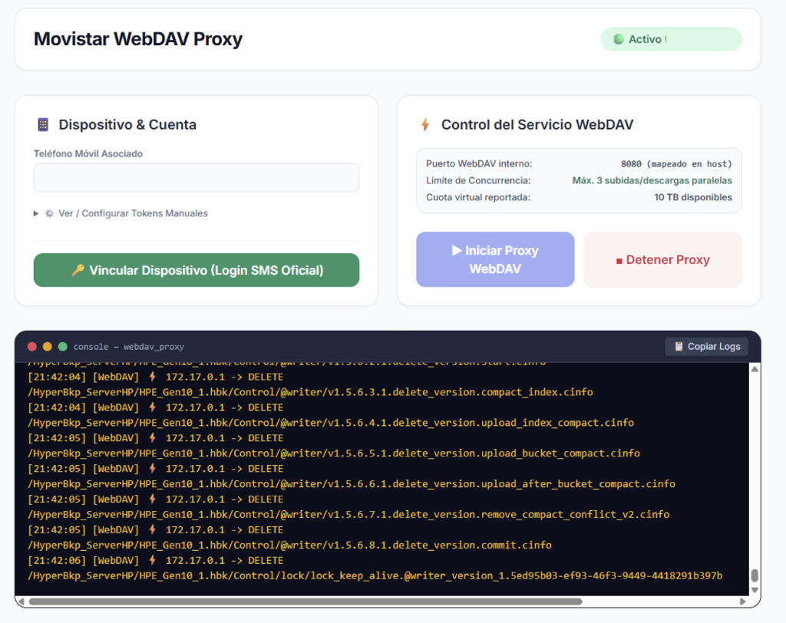

# Movistar Cloud WebDAV Proxy ☁️🔐

[](https://hub.docker.com/r/uniextra/movistar-webdav-proxy)
[](https://opensource.org/licenses/MIT)
[](https://tools.ietf.org/html/rfc4918)

A lightweight Docker WebDAV proxy that seamlessly translates standard WebDAV backup requests (**Duplicati**, **Synology HyperBackup**, **rclone**, etc.) into the proprietary **Movistar Cloud Spain (Files)** API in real-time.

Turn your unlimited Movistar Cloud storage into a transparent, secure, and remote destination for your server, NAS, and personal backups.

<p align="center">
  
</p>

---

## 🌟 Key Features

* 🔄 **Full WebDAV Method Translation (RFC 4918):**
  * `PROPFIND` (automatic server-side pagination overcoming Movistar's default 200-item limit).
  * `PUT` (disk-buffered streaming upload supporting files of any size without RAM exhaustion).
  * `GET` & `HEAD` (streaming downloads with chunk decoding and gzip decompression to prevent *Hash Mismatch* corruption).
  * `MKCOL` (folder creation with instant ID resolution and nested directory support for `.hbk` archives).
  * `DELETE` (clean pruning of files and collections).
  * `MOVE` & `COPY` (atomic server-side renaming/moving, essential for Duplicati's `.tmp` -> `.zip.aes` workflow).
  * `LOCK` & `UNLOCK` (in-memory lock manager backed by WsgiDAV).
* 📊 **RFC 4331 Storage Quota Support:**
  * Reports virtual quota (`quota-available-bytes`) and usage so that Synology DSM and backup wizards pass pre-flight checks without *"Insufficient storage"* errors.
* 🛡️ **Eventual Consistency & Collision Resilience:**
  * Hides Movistar CDN indexing propagation delays via an intelligent transient cache and automatic retries.
  * Deletes superseded cloud files prior to overwriting to prevent Movistar from generating ` (1)` duplicate suffix collisions.
  * On-the-fly filename normalization ensuring backup software always receives canonical file paths.
* 🚦 **Concurrency Semaphore (Max 3 Transfers):**
  * Strictly bounds heavy concurrent uploads and downloads to 3 parallel streams to operate in Movistar Cloud's optimal throughput band without API rate-limiting or socket resets, keeping control threads fluid.
* 🔑 **Permissive Client Authentication:**
  * Accepts any username and password in your WebDAV client (Synology DSM and Duplicati require these fields); the proxy authorizes requests internally using your active account credentials.
* 💻 **Native Desktop OAuth 2.0 & In-Band SAPI Token Rotation (`v1.1.0`):**
  * Emulates the official Movistar Cloud Windows desktop client (`omh windows client 32.0.7.1`, `platform="windows"`, `scope="openid"`, and `fol-<base64_md5>` `X-deviceid` matching the `brand.dll` OAuth2 client `b99e5095-7a36-42c1-83b6-6f05d0f13ea1`).
  * **64-bit Millisecond `lastrefreshdate` Synchronization:** Preserves the exact 13-digit server timestamp (`responsetime` / `lastrefreshdate`) returned by `GET /sapi/login/oauth?action=login&responsetime=true` so the Java SAPI backend accurately tracks token validity across hours and days.
  * **In-Band Token Rotation (`processAuthenticationResponse`):** Inspects every SAPI HTTP response for `Authorization: oauth <base64>` headers and atomically persists rotated `accesstoken`, `refreshtoken`, `lastrefreshdate`, and `validationkey` values to disk.
  * **Zero session conflicts:** You can log into Movistar Cloud via web browsers or mobile apps without ever kicking the WebDAV proxy offline.
* 💓 **Automatic Keep-Alive & Multi-Layer Session Recovery:**
  * Periodically validates session health via `/sapi/system/information?action=get` and automatically re-initializes Tomcat sessions (`JSESSIONID` + `validationkey`) via `/sapi/login/oauth?action=login&responsetime=true` on `HTTP 401`, protected by cross-process `fcntl.flock` locks.
* 🖥️ **Integrated noVNC SMS Login Assistant:**
  * Clean web dashboard on port `5000` with an embedded noVNC virtual browser for seamless one-click SMS verification; credentials and tokens are captured and saved automatically.
* 🚀 **Autonomous Auto-Start:**
  * On container startup or reboot, the proxy detects saved credentials in `/app/tokens` and starts the WebDAV service in milliseconds without manual intervention.

---

## 🐳 Docker Deployment

### Option 1: Docker Compose (Recommended)

Create a `docker-compose.yml` file:

```yaml
version: '3.8'

services:
  movistar-webdav-proxy:
    image: uniextra/movistar-webdav-proxy:latest
    build: .
    container_name: movistar-webdav-proxy
    restart: unless-stopped
    ports:
      - "5000:5000"      # Web Management UI & logs
      - "5050:8080"      # WebDAV Endpoint (map to 5050 on host to avoid port 8080 conflicts)
      - "8084:8084"      # noVNC Virtual Browser (SMS login)
    volumes:
      - movistar_tokens:/app/tokens

volumes:
  movistar_tokens:
    name: movistar_webdav_tokens
```

Start the service:
```bash
docker compose up -d
```

### Option 2: Docker CLI

```bash
docker run -d \
  --name movistar-webdav-proxy \
  --restart unless-stopped \
  -p 5000:5000 \
  -p 5050:8080 \
  -p 8084:8084 \
  -v movistar_webdav_tokens:/app/tokens \
  uniextra/movistar-webdav-proxy:latest
```

---

## 🔑 Initial Setup & Authentication (Device Pairing)

1. Open your web browser and navigate to the management dashboard: `http://YOUR_SERVER_IP:5000`.
2. Enter your mobile phone number associated with Movistar Cloud and click **"Vincular Dispositivo"**.
3. A modal with an embedded noVNC virtual browser will appear.
4. Enter the SMS verification code received on your phone.
5. The proxy captures the session credentials, registers the device, saves persistent tokens into `/app/tokens`, and boots the WebDAV service immediately.
6. The dashboard will show the active state, and the WebDAV service will begin accepting requests on port `8080` (or `5050` based on your host port mapping).

---

## ⚙️ Backup Client Configuration

### 1. Duplicati Setup

In the Duplicati destination setup wizard:

| Setting | Value |
| :--- | :--- |
| **Storage Type** | `WebDAV` |
| **Server** | Your server IP (e.g. `192.168.1.100`) |
| **Port** | `5050` (or the host port mapped to `8080`) |
| **Path on server** | Target folder name (e.g. `Backup_Duplicati` or `/Backup_Duplicati/`) |
| **Integrated connection (SSL)** | Disabled (unless using an external HTTPS reverse proxy) |
| **Username** | Any value (e.g. `admin`) |
| **Password** | Any value (e.g. `admin`) |

> [!TIP]
> Click **"Test connection"**; Duplicati will verify permissions and create the remote directory automatically.

---

### 2. Synology HyperBackup Setup

In DSM HyperBackup wizard:

1. Select **WebDAV** as the backup destination.
2. Fill in the connection settings:
   * **Server address:** `http://YOUR_DOCKER_HOST_IP:5050`
   * **Username:** `admin` (or any string)
   * **Password:** `admin` (or any string)
   * **Folder:** Select or enter a dedicated folder for HyperBackup (e.g. `HyperBackup_NAS`).
   * **Directory:** Repository name (e.g. `Server_Backup.hbk`).
3. Complete the wizard. The backup task will report **Online** and is ready for scheduled or on-demand backups.

> [!IMPORTANT]
> **Best Practice:** Keep separate folders in Movistar Cloud for Duplicati and HyperBackup (e.g. `/Duplicati_Server/` and `/HyperBackup_NAS/`) so that each application manages its indices in complete isolation.

---

## 🧪 Tests & Verification

The repository includes a comprehensive unit and integration test suite:

```bash
python test_webdav_suite.py
```

Validates:
* Download stream concurrency and binary chunk decoding.
* Collision normalization (` (1)` suffix pruning and `.hbk` directory resolution).
* RFC 4331 quota reporting.
* Rejection of API error JSON payloads disguised with HTTP 200 OK status.

---

## 🚀 What's New in v1.1.0

* **Fixed OAuth2 Platform & `client_id` Alignment (`platform="windows"`):** Aligned `Authorization: oauth <base64>` payload (`platform="windows"`, `scope="openid"`, `User-Agent: omh windows client 32.0.7.1`, `X-deviceid: fol-<base64_md5>`) with the official Windows client `brand.dll` (`b99e5095-7a36-42c1-83b6-6f05d0f13ea1`), preventing Telefónica's OAuth backend (`apiseg.telefonica.es`) from revoking tokens with `Invalid Token` upon server-side refresh.
* **Fixed 64-bit Millisecond `lastrefreshdate` Handling (13 digits):** Replicated `Funambol::OAuth2JsonParser::formatOAuth2CredentialData` and `OAuth2LoginHandler::performLogin` (`GET /sapi/login/oauth?action=login&responsetime=true`) so `lastrefreshdate` is stored and transmitted in 13-digit Unix milliseconds instead of 10-digit seconds.
* **Added In-Band SAPI Token Rotation Capture (`processAuthenticationResponse`):** Every SAPI HTTP response is inspected for updated `Authorization: oauth <base64>` headers and session cookies (`JSESSIONID`, `validationkey`), atomically persisting rotated credentials across all worker processes.
* **Cross-Process Browser Profile Locking:** Added `fcntl.flock` synchronization (`/tmp/movistar_renew_web.lock` and `/tmp/movistar_refresh_token.lock`) to eliminate Chromium `SingletonLock` collisions during concurrent 401 recovery.

---

## 📄 License

This project is licensed under the [MIT License](LICENSE).
