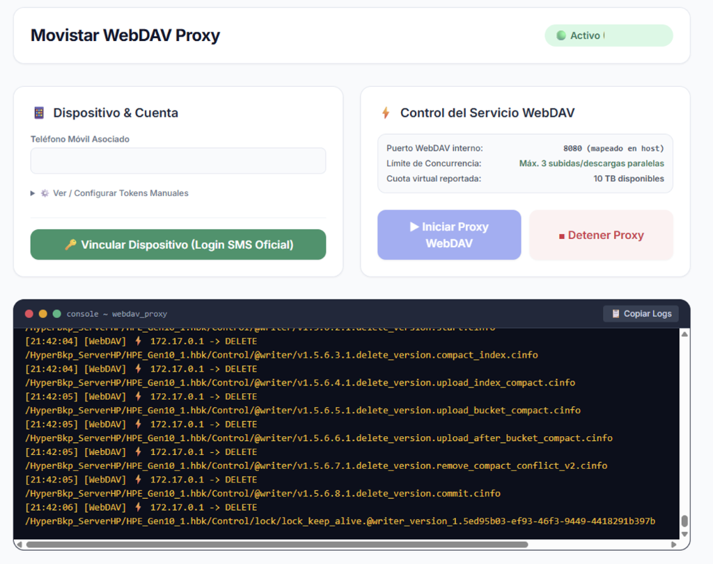

# Movistar / O2 Cloud WebDAV Proxy ☁️🔐

[](https://hub.docker.com/r/uniextra/movistar-webdav-proxy)
[](https://hub.docker.com/r/uniextra/movistar-webdav-proxy)
[](https://ko-fi.com/uniextra)
[](https://hub.docker.com/r/uniextra/movistar-webdav-proxy)
[](https://hub.docker.com/r/uniextra/movistar-webdav-proxy)

> [!WARNING]
> **Proyecto en desarrollo activo:** Este proyecto evoluciona de forma constante para mejorar la estabilidad y la compatibilidad con Movistar/O2 Cloud. Revisa el [CHANGELOG.md](CHANGELOG.md) y la documentación antes de actualizar.

> [!NOTE]
> **Aviso de Proyecto No Oficial e Independiente:** Software comunitario para interoperabilidad y copias de seguridad personales. No está afiliado ni respaldado por Telefónica, S.A., Movistar ni O2. Consulta [DISCLAIMER.md](DISCLAIMER.md) y [TRADEMARKS.md](TRADEMARKS.md).

Proxy WebDAV nativo de alto rendimiento escrito en **Go** que traduce peticiones estándar WebDAV (**Synology HyperBackup**, **Duplicati**, **Rclone**, unidades de red en **Windows / macOS / Linux**) para conectar directamente con **Movistar Cloud España** y **O2 Cloud** de forma local y en tiempo real.

<p align="center">
  
</p>

---

## 📑 Índice de Contenidos

1. [🌟 Características Principales](#-características-principales)
2. [🐳 Paso 1: Despliegue con Docker](#-paso-1-despliegue-con-docker)
3. [🔑 Paso 2: Vinculación Inicial de la Cuenta](#-paso-2-vinculación-inicial-de-la-cuenta)
4. [🔌 Paso 3: Conectar Clientes y Unidades de Red](#-paso-3-conectar-clientes-y-unidades-de-red)
5. [🌐 Explorador Web (`:5050`)](#-explorador-web-5050)
6. [🖼️ Galería Virtual (`/_gallery`) — Opcional](#️-galería-virtual-_gallery--opcional)
7. [⚙️ Variables de Entorno Principales y Alertas de Telegram](#️-variables-de-entorno-principales-y-alertas-de-telegram)
8. [⚠️ Aspectos Clave a Tener en Cuenta](#️-aspectos-clave-a-tener-en-cuenta)
9. [📚 Documentación Detallada](#-documentación-detallada)
10. [⚖️ Aviso Legal y Marcas](#️-aviso-legal-y-marcas)
11. [📄 Licencia](#-licencia)

---

## 🌟 Características Principales

* 🚀 **Ligero y Nativo en Go:** Imagen Docker de solo **~20 MB** y consumo de apenas **~6.5 MB de RAM** (ejecutado sin privilegios *non-root*).
* 🔄 **WebDAV Completo (RFC 4918) + Cuotas Virtuales:** Compatible con `PROPFIND`, `PUT` en streaming, `GET`/`HEAD` con `Range`, `MKCOL`, `DELETE`, `MOVE`, `COPY`, bloqueos `LOCK`/`UNLOCK` y espacio virtual RFC 4331 para HyperBackup y Duplicati.
* 🚦 **Control de Concurrencia y Resiliencia WAF:** Gestiona subidas y descargas paralelas (`2` subidas / `4` descargas por defecto), huella TLS adaptada y protección frente a colisiones de nombres o bloqueos de CloudFront.
* 🔔 **Alertas de Telegram desde el Arranque (v2.5.6):** Notificaciones automáticas desde el primer segundo si configuras `TELEGRAM_BOT_TOKEN` y `TELEGRAM_CHAT_ID` (aviso de inicio, cuenta sin vincular, caducidad de sesión o fallos críticos), sin necesidad de abrir antes el panel web.
* 🌐 **Explorador Web Ágil (`:5050`) y Sesión Compartida:** Activo por defecto desde la `v2.7.0` (incluso con `GALLERY_ENABLED=false`). Permite navegar por tus carpetas («Mis Archivos»), buscar al instante, crear carpetas, subir archivos por **Drag & Drop**, descargar, renombrar, borrar y ver fotos/vídeos con visor multimedia 100 % offline, compartiendo sesión desde **📁 Explorador** en el Dashboard (`:5000`).
* 🖼️ **Galería Virtual (`/_gallery`):** Carpeta virtual opcional para listar, descargar, subir y borrar fotos y vídeos sueltos de la Galería (`folder_id = 0`) clasificados automáticamente por fecha (`AAAA/MM`).
* 🌐 **Modo Web Opcional:** Alternativa basada en la sesión web oficial (`micloud.movistar.es`) con renovación automática cada 24 h si el flujo OAuth del cliente de escritorio falla. Ver [docs/web-mode.md](docs/web-mode.md).
* 🍓 **Ligero también en equipos pequeños:**
  * cola de subidas común con contrapresión y prioridades;
  * subida directa opcional sin nada en disco (`WEBDAV_UPLOAD_SPOOL=false`);
  * TLS con ChaCha20 en procesadores sin AES por hardware;
  * conexiones muertas cerradas en un minuto (`TCP_USER_TIMEOUT`).
* 📊 **Informe de copias desde el cliente:** un script con rclone puede informar de su progreso para verlo en el panel y recibir un resumen por Telegram al terminar ([cómo usarlo](docs/configuration.md#-9-conexiones-e-informe-de-copias)).
* 🧹 **Filtro de Basura del SO y Panel de Transferencias:** Absorbe automáticamente archivos ocultos del sistema (`.DS_Store`, `desktop.ini`, `thumbs.db`) y muestra velocidad, progreso y logs en tiempo real desde la interfaz web.

---

## 🐳 Paso 1: Despliegue con Docker

> [!TIP]
> **¿Prefieres configurarlo sin editar YAML a mano?** Usa el **[Generador Web Interactivo](https://uniextra.github.io/MovistarWebDAVProxy/)** para elegir tus opciones (Galería, Telegram, baja RAM, Modo Web, proxy inverso, Rclone/Synology/Duplicati) y copiar o descargar tu `docker-compose.yml`, `docker run` o `.env` listo para usar *(100 % local en tu navegador)*.

### Opción 1: Docker Compose (Recomendado)

Crea un archivo `docker-compose.yml` (también puedes partir directamente del [`docker-compose.yml`](docker-compose.yml) del repositorio):

```yaml
services:
  movistar-webdav-proxy:
    image: uniextra/movistar-webdav-proxy:latest
    container_name: movistar-webdav-proxy
    restart: unless-stopped
    read_only: true
    tmpfs:
      - /tmp
    security_opt:
      - no-new-privileges:true
    environment:
      - TZ=Europe/Madrid
      - WEBDAV_USER=admin
      - WEBDAV_PASSWORD=TuPasswordSeguroAqui
      # Opcional: credenciales distintas para el panel web (si no se definen, usa las de WebDAV)
      # - WEBUI_USER=admin
      # - WEBUI_PASSWORD=OtroPasswordSeguro
      # Opcional: puerto externo del explorador WebDAV si no usas 5050
      # - WEBDAV_HOST_PORT=5050
      # Opcional: carpeta virtual de Galería (/_gallery)
      # - GALLERY_ENABLED=true          # Expone /_gallery en WebDAV y Explorador Web
      # - GALLERY_LAYOUT=year-month     # year-month (/AAAA/MM, recomendado) o flat
      # - GALLERY_DIR=_gallery          # Nombre de la carpeta virtual en /
      # - GALLERY_UPLOAD=true           # Permite subir fotos/vídeos a /_gallery
      # - GALLERY_DELETE=true           # Permite mandar elementos de /_gallery a la papelera
      # Opcional: notificaciones de Telegram activas desde el arranque del contenedor
      - TELEGRAM_BOT_TOKEN=
      - TELEGRAM_CHAT_ID=
      # Opcional: cifrar en reposo (AES-256-GCM) los tokens guardados en /app/tokens
      # - TOKENS_ENCRYPTION_KEY=TuClaveMaestraDeCifrado
      # Opcional: guardar archivos temporales grandes en disco en lugar de RAM (/tmp)
      # - WEBDAV_TMPDIR=/app/tmp
    ports:
      - "${BIND_IP:-0.0.0.0}:5000:5000"   # Panel Web de Gestión y Logs (usa BIND_IP=127.0.0.1 para solo localhost)
      - "${BIND_IP:-0.0.0.0}:5050:8080"   # Endpoint WebDAV y Explorador Web (puerto 5050 en el host)
    volumes:
      - movistar_tokens:/app/tokens
      # Opcional (requiere WEBDAV_TMPDIR=/app/tmp): útil en NAS con poca RAM para subidas grandes
      # - /ruta/en/tu/nas/tmp:/app/tmp

volumes:
  movistar_tokens:
    name: movistar_webdav_tokens
```

Inicia el contenedor:
```bash
docker compose up -d
```

### Opción 2: Docker CLI

```bash
docker run -d \
  --name movistar-webdav-proxy \
  --restart unless-stopped \
  -e TZ=Europe/Madrid \
  -e WEBDAV_USER=admin \
  -e WEBDAV_PASSWORD=TuPasswordSeguroAqui \
  -e TELEGRAM_BOT_TOKEN= \
  -e TELEGRAM_CHAT_ID= \
  -p 5000:5000 \
  -p 5050:8080 \
  -v movistar_webdav_tokens:/app/tokens \
  uniextra/movistar-webdav-proxy:latest
```

---

## 🔑 Paso 2: Vinculación Inicial de la Cuenta

### Opción A (Recomendada): Emparejamiento por SMS (OAuth2)

1. Abre tu navegador y entra al panel de control: `http://IP_DE_TU_SERVIDOR:5000`.
2. Inicia sesión con tus credenciales (`WEBDAV_USER` / `WEBDAV_PASSWORD`, o `WEBUI_*` si las definiste).
3. Haz clic en **"Vincular Dispositivo (OAuth2 SMS)"**, elige **Movistar Cloud** u **O2 Cloud** e introduce tu número de móvil.
4. Pulsa **"Abrir Página de Login en Nueva Pestaña"**, accede al portal oficial de Telefónica e introduce el código SMS recibido.
5. Copia la URL final redirigida (ej. `https://micloud.movistar.es/...code=...`), pégala en el panel y pulsa **"Completar Vinculación"**.
6. ¡Listo! El servidor WebDAV quedará activo en el puerto `5050`.

### Opción B (Alternativa): Modo Web con navegador integrado

Si el emparejamiento por SMS del cliente de escritorio falla o es bloqueado en tu línea, puedes usar la **sesión web oficial** mediante un Chromium integrado sin pantalla (solo Movistar Cloud):

```bash
docker compose -f docker-compose.web.yml up -d --build
```

Abre el panel web (`:5000`), pulsa **🔐 Abrir inicio de sesión**, entra con **e-mail y contraseña** y marca **«No cerrar sesión»** para que el proxy la renueve automáticamente. Consulta todos los detalles en [docs/web-mode.md](docs/web-mode.md).

---

## 🔌 Paso 3: Conectar Clientes y Unidades de Red

### 🛡️ Clientes de Copia de Seguridad

* **Synology HyperBackup:** Destino `WebDAV` → `http://TU_IP:5050` → Usuario/Clave `WEBDAV_USER` / `WEBDAV_PASSWORD` → Carpeta `HyperBackup_NAS` → Directorio `Copia.hbk`.
* **Duplicati:** Tipo de almacenamiento `WebDAV` → Servidor `TU_IP`, puerto `5050` → Ruta `Duplicati_Server`.
* **Rclone:** Configura un remoto `type = webdav` con `vendor = owncloud` apuntando a `http://TU_IP:5050`. Si vas a subir archivos individuales de **más de 4 GB**, añade el overlay `chunker` (y opcionalmente `crypt`).

👉 **Paso a paso, capturas y configuración completa de Rclone (`chunker` + `crypt`) en [docs/backup-clients.md](docs/backup-clients.md).**

### 💻 Mapear como Unidad de Red

| Sistema Operativo | Método Recomendado | Ruta / Comando Rápido |
| :--- | :--- | :--- |
| **🪟 Windows** | **Rclone + WinFsp** *(el WebClient nativo está obsoleto)* | `rclone mount movistar: M: --vfs-cache-mode full` |
| **🍏 macOS** | Finder (`Cmd + K`) | `http://TU_IP:5050` |
| **🐧 Linux** | GNOME Files / KDE / `davfs2` / Rclone | `dav://TU_IP:5050/` o `mount -t davfs http://TU_IP:5050 /mnt/cloud` |
| **🗄️ Synology DSM** | File Station (*Herramientas → Conexión remota*) | [Ver guía paso a paso](docs/network-drive.md#-4-synology-dsm-file-station) |

👉 **Guía completa por sistema operativo (incluyendo montaje nativo experimental en Windows) en [docs/network-drive.md](docs/network-drive.md).**

---

## 🌐 Explorador Web (`:5050`)

Desde la versión **`v2.7.0`**, el explorador web viene **activo por defecto** en **`http://IP_DE_TU_SERVIDOR:5050/`**, **aunque no tengas activada la galería virtual (`GALLERY_ENABLED=false`)**. Además de conectar clientes WebDAV (WinSCP, Rclone, Finder, Synology File Station, etc.), puedes gestionar directamente tus carpetas y archivos desde cualquier navegador:

* **Gestión completa de archivos y carpetas («Mis Archivos»):** Crea carpetas (**+ Carpeta**), sube archivos arrastrando y soltando (**Drag & Drop** conservando la fecha de modificación `X-OC-Mtime`), descarga, renombra o envía elementos a la papelera desde el menú `⋮`. *(Nota: en carpetas, Movistar/O2 Cloud no proporciona tamaño agregado desde la API).*
* **Acceso único con el Dashboard (`:5000`):** Inicia sesión en `:5000` y pulsa **📁 Explorador** en la cabecera para entrar en `:5050` sin volver a introducir usuario y contraseña *(si publicas WebDAV en otro puerto distinto de `5050`, define `WEBDAV_HOST_PORT`)*. Si abres `:5050` directamente en el navegador, te mostrará la pantalla de login web (`/__login`) en lugar de la ventana nativa Basic Auth.
* **Vista en modo listado 100 % offline + visor multimedia:** Tabla ligera y rápida (sin miniaturas pesadas de imágenes), búsqueda instantánea (`/`), filtro por tipo, ordenación por columnas y *breadcrumbs*. Al abrir cualquier foto o vídeo se muestra en un **visor integrado** para avanzar o retroceder entre ellos (`‹` / `›` y teclas `←` / `→`) sin salir del explorador.

---

## 🖼️ Galería Virtual (`/_gallery`) — Opcional

Si además activas **`GALLERY_ENABLED=true`**, aparece tanto en WebDAV como en el Explorador Web la carpeta **`/_gallery`** con las fotos y vídeos de tu Galería que no pertenecen a carpetas de «Mis Archivos» (`folder_id = 0`).

* **Las carpetas `AAAA/MM` son virtuales:** **No existen** como carpetas reales en Movistar ni en O2 Cloud. Es el proxy quien clasifica dinámicamente cada foto o vídeo en `/AAAA/MM` (o `/unknown` si no tiene fecha) según la fecha real del elemento.
* **Sin mover nada entre carpetas y sin duplicados:** No hace falta subir a una carpeta temporal para luego mover el archivo; si subes una foto a `/_gallery/` (o dentro de cualquier subcarpeta `AAAA/MM`), el proxy la envía a la Galería y la coloca automáticamente en el año y mes que corresponda a su fecha. Si vuelves a subir un archivo con el mismo nombre a `/_gallery/`, se sobrescribe *in-place* sin crear duplicados.
* **¿Cómo se calcula la fecha al subir (`GALLERY_UPLOAD=true`)?** Por orden de prioridad:
  1. Cabecera **`X-OC-Mtime`** (la envían clientes como el **Explorador Web `:5050`** o Rclone).
  2. Metadatos **EXIF** internos de la foto (`DateTimeOriginal` / `DateTimeDigitized` / `DateTime`).
  3. **Fecha deducida del nombre del archivo** (útil para capturas PNG sin EXIF, p. ej. `Captura de pantalla AAAA-MM-DD HHMMSS`, `Screenshot_AAAAMMDD-HHMMSS`, `IMG_AAAAMMDD_HHMMSS` o WhatsApp `IMG-AAAAMMDD-WA...`).
  * 💡 **Consejo para archivos sin EXIF (escaneos, capturas o descargas de PC):** Muchos clientes WebDAV (como el Explorador de Windows o WinSCP en determinadas subidas) no envían la fecha del sistema de archivos antes del `PUT` (en Windows puedes ver una fecha en las propiedades del archivo aunque el fichero no lleve etiqueta EXIF interna). En esos casos, súbelos por **Drag & Drop desde el Explorador Web (`:5050`)** o añade las cabeceras de fecha antes de subir con herramientas gratuitas como **ExifTool** o **ExifToolGUI**.

> [!WARNING]
> Si activas `GALLERY_ENABLED=true` y ejecutas `rclone sync <local> remoto:` contra la raíz `/`, añade **`--exclude "/_gallery/**"`** (o el nombre que uses en `GALLERY_DIR`) para evitar que `rclone` intente borrar la carpeta virtual.

---

## ⚙️ Variables de Entorno Principales y Alertas de Telegram

Estas son las variables habituales para el primer despliegue:

| Variable | Por defecto | Descripción |
| :--- | :--- | :--- |
| `WEBDAV_USER` | *(vacío)* | Usuario para clientes WebDAV (y para el panel web si `WEBUI_USER` no se define). |
| `WEBDAV_PASSWORD` | *(vacío)* | Contraseña para clientes WebDAV. |
| `WEBDAV_HOST_PORT` | `5050` | Puerto externo del explorador WebDAV enlazado desde el botón **📁 Explorador** del panel (`:5000`). |
| `WEBUI_USER` | `WEBDAV_USER` | Usuario independiente opcional para acceder al panel web (`:5000`). |
| `WEBUI_PASSWORD` | `WEBDAV_PASSWORD` | Contraseña independiente opcional para el panel web. |
| `GALLERY_ENABLED` | `false` | Activa la carpeta virtual `/_gallery` en WebDAV y el explorador web (solo lectura por defecto). |
| `GALLERY_DIR` | `_gallery` | Nombre de la carpeta virtual en `/` (si existe una carpeta real con ese nombre, prevalece la real). |
| `GALLERY_LAYOUT` | `year-month` | Organización virtual: `year-month` (`/AAAA/MM` y `/unknown`, recomendada) o `flat`. |
| `GALLERY_UPLOAD` | `false` | Permite subir fotos/vídeos directamente a `/_gallery` (conservando `X-OC-Mtime`, EXIF o fecha del nombre). |
| `GALLERY_DELETE` | `false` | Permite enviar a la papelera elementos de `/_gallery` (mantiene bloqueado borrar carpetas virtuales). |
| `TELEGRAM_BOT_TOKEN` | *(vacío)* | Token de tu bot de Telegram para alertas operativas y de sesión. |
| `TELEGRAM_CHAT_ID` | *(vacío)* | Chat o canal de Telegram donde recibir las notificaciones. |
| `TOKENS_ENCRYPTION_KEY` | *(vacío)* | Clave maestra opcional para cifrar con **AES-256-GCM** los tokens guardados en disco. |
| `TZ` | `Europe/Madrid` | Zona horaria del contenedor para logs y alertas. |

### 🔔 Notificaciones de Telegram (PR #53)

Al incluir `TELEGRAM_BOT_TOKEN` y `TELEGRAM_CHAT_ID` en tu `docker-compose.yml`, el notificador global queda activo desde el arranque sin tener que entrar primero al panel web:
* **Arranque y estado inicial:** Notifica cuando el proxy inicia y avisa si la cuenta aún está pendiente de vinculación o de inicio de sesión web.
* **Errores y caducidad:** Avisa ante fallos críticos de inicialización o cuando la sesión de Movistar/O2 caduca (con límite antispam de 1 hora por alerta).
* **Prioridad y respaldo:** Si configuras Telegram desde el panel web, esas credenciales se guardan en `/app/tokens`; si desvinculas la cuenta, el proxy vuelve a usar automáticamente los valores de entorno de Docker.

👉 **Consulta la referencia completa de variables avanzadas (`SAPI_USER_AGENT`, `DESKTOP_USER_AGENT`, `TRUSTED_PROXIES`, `WEBDAV_TMPDIR`, concurrencia), configuración de Nginx Reverse Proxy y detalles de seguridad en [docs/configuration.md](docs/configuration.md).**

---

## ⚠️ Aspectos Clave a Tener en Cuenta

1. **📦 Límite de 4 GB por archivo en Movistar / O2 Cloud:** La API de Telefónica rechaza archivos individuales mayores de **4 GB (4096 MB)**. **Duplicati** y **HyperBackup** dividen los datos automáticamente en bloques pequeños; para archivos grandes sueltos con **Rclone**, usa [`chunker`](docs/backup-clients.md#-configuración-avanzada-archivos-de-más-de-4-gb-chunker-y-cifrado-crypt).
2. **🧹 Limpieza automática de archivos del SO:** El proxy absorbe sin subir a la nube ficheros temporales de sistema como `.DS_Store`, `._*`, `desktop.ini`, `thumbs.db`, `$RECYCLE.BIN` o `.Trash-*`.
3. **🔒 Acceso remoto seguro:** No expongas los puertos `:5000` o `:5050` directamente a Internet sin cifrado. Si necesitas acceso externo, usa una VPN (WireGuard / Tailscale) o un proxy inverso con **HTTPS** configurado según [docs/configuration.md](docs/configuration.md#-6-topologías-de-red-docker-y-proxies-inversos).

---

## 📚 Documentación Detallada

* [🧩 Generador Web Interactivo (Compose, `docker run`, `.env`, Rclone, Synology y Duplicati)](https://uniextra.github.io/MovistarWebDAVProxy/)
* [🔧 Configuración Avanzada, Seguridad, Proxies Inversos y Variables de Entorno](docs/configuration.md)
* [🛡️ Configurar Synology HyperBackup, Duplicati y Rclone (>4 GB y Cifrado)](docs/backup-clients.md)
* [💻 Mapear como Unidad de Red en Windows, macOS y Linux](docs/network-drive.md)
* [🌐 Modo Web: sesión del navegador, renovación automática y subida web](docs/web-mode.md)

---

## ⚖️ Aviso Legal y Marcas

* [📋 Descargo de Responsabilidad (DISCLAIMER.md)](DISCLAIMER.md)
* [🏷️ Política de Marcas Registradas (TRADEMARKS.md)](TRADEMARKS.md)

---

## 📄 Licencia

Este proyecto está bajo licencia [MIT](LICENSE).
